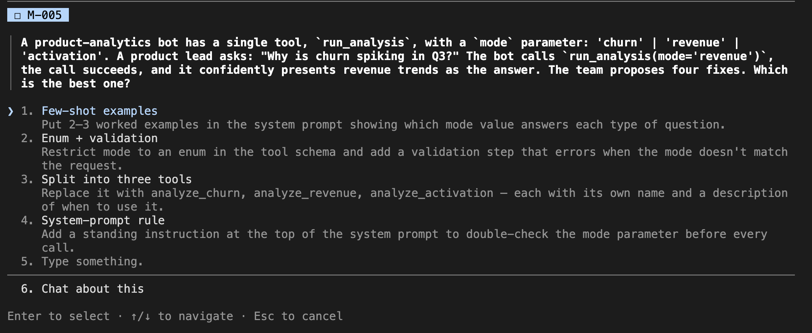
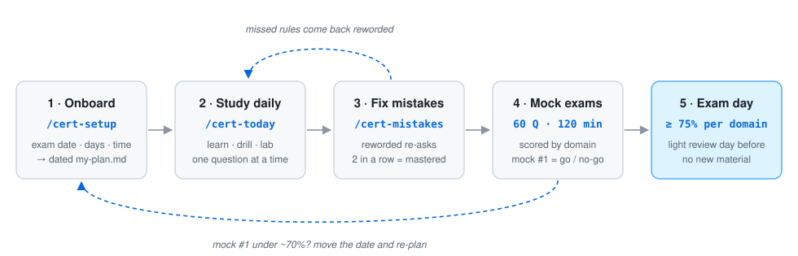
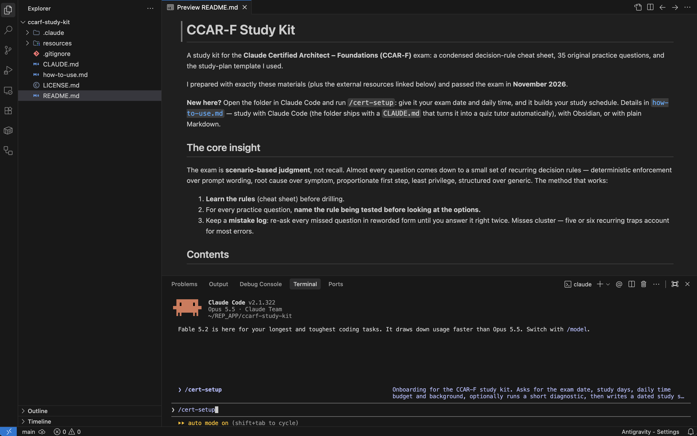

# CCAR-F Study Kit

A study kit for the **Claude Certified Architect – Foundations (CCAR-F)** exam: a condensed decision-rule cheat sheet, 35 original practice questions, and the study-plan template I used.

I prepared with exactly these materials (plus the external resources linked below) and passed the exam in **November 2026**.

**New here?** Open the folder in Claude Code and run `/cert-setup`: give it your exam date and daily time, and it builds your study schedule. Details in [`how-to-use.md`](how-to-use.md) — study with Claude Code (the folder ships with a `CLAUDE.md` that turns it into a quiz tutor automatically), with Obsidian, or with plain Markdown.

*A reworded re-ask from the mistake log. The tutor asks one question at a time and explains every distractor after you answer.*

## The core insight

The exam is **scenario-based judgment**, not recall. Almost every question comes down to a small set of recurring decision rules — deterministic enforcement over prompt wording, root cause over symptom, proportionate first step, least privilege, structured over generic. The method that works:

1. **Learn the rules** (cheat sheet) before drilling.
2. For every practice question, **name the rule being tested before looking at the options.**
3. Keep a **mistake log**: re-ask every missed question in reworded form until you answer it right twice. Misses cluster — five or six recurring traps account for most errors.

## How it works

Open the folder in Claude Code (terminal or IDE), run `/cert-setup` once, then `/cert-today` each day:

## Contents

| File | What it is |
|---|---|
| [`resources/cheat-sheet.md`](resources/cheat-sheet.md) | 18 meta-rules ("answer DNA") + per-domain decision tables + distractor patterns |
| [`resources/practice-questions.md`](resources/practice-questions.md) | 35 original scenario questions in the exam's style, 7 scenarios, answers folded |
| [`resources/study-plan-template.md`](resources/study-plan-template.md) | Exam facts, a 3-phase plan structure, go/no-go rule, exam-day tactics |
| [`how-to-use.md`](how-to-use.md) | How to study with it: Claude Code tutor mode, Obsidian, or plain Markdown |
| [`CLAUDE.md`](CLAUDE.md) | Tutor instructions Claude Code reads automatically — `git clone`, `cd`, `claude`, and quiz |
| [`images/`](images/) | Screenshots and the study-loop diagram used in this README |
| [`.claude/skills/`](.claude/skills/) | Bundled skills — `/cert-setup` (onboarding: exam date → dated study plan), `/cert-today`, `/cert-drill`, `/cert-mistakes` — the same tutor sessions as one-key commands |

## External resources (linked, not bundled — respect their licenses)

- **Official exam guide & access request** — https://anthropic.skilljar.com/claude-certified-architect-foundations-access-request
- **Community study guide** (long-form theory with code) — https://github.com/paullarionov/claude-certified-architect
- **claudecertificationguide.com** — 30 learning modules, diagnostic, drill mode, mock exam — https://claudecertificationguide.com/learn

## Scope & disclaimers

- **Not affiliated with, endorsed by, or produced by Anthropic.** "Claude" and the certification name are Anthropic's.
- Exam facts (format, pricing, weights, retake policy) reflect the **official guide v1.0 (July 2026)** plus community-reported changes through Nov 2026 (scenario pool now 8, GA pricing) — verify against the official page before booking.
- All questions in `resources/practice-questions.md` are **original** and were written *before* the author sat the exam. No actual exam content is included, and none should ever be added — certification agreements prohibit disclosing exam questions.

## License

© 2026 Jaafar MADIH. Original content in this repo (cheat sheet, practice questions, plan template, tutor instructions, skills) is licensed **[CC BY 4.0](https://creativecommons.org/licenses/by/4.0/)** — reuse and adapt with attribution to Jaafar MADIH. See [`LICENSE.md`](LICENSE.md).
